# NEXRAD Workbench

**Weather radar in your browser, live or from any day since 1991.**

NEXRAD Workbench streams data from the U.S. network of NEXRAD (WSR-88D)
Doppler weather radars and draws it on a map, in 2D or on a 3D globe. Watch a storm
as the radar sweeps it, or scrub back through decades of archive. No install,
no account, no server: everything runs on your own device.

### [▶ Open NEXRAD Workbench](https://danielway.github.io/nexrad-workbench/)

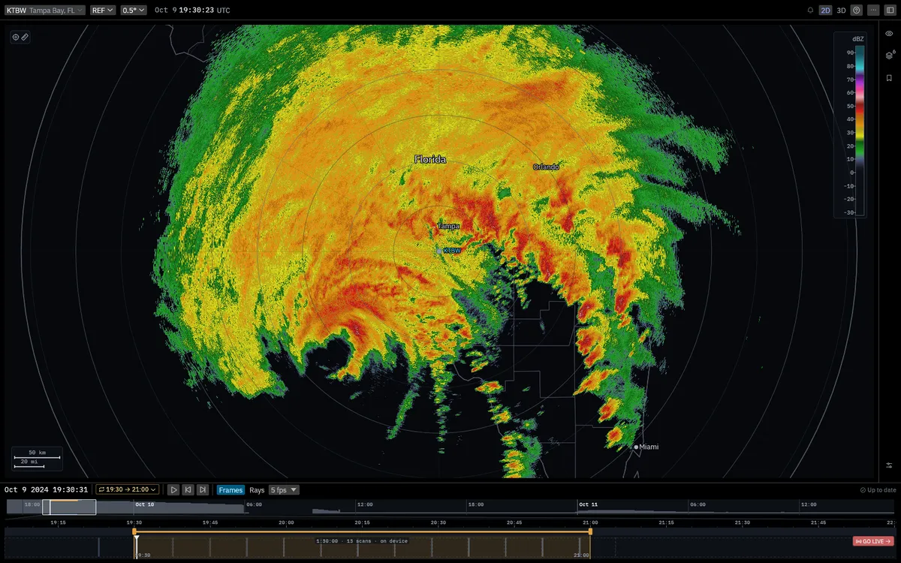

Hurricane Milton approaching Tampa Bay, 9 October 2024, from the KTBW radar. One volume every seven minutes over 90 minutes.

## What you can do

- **Watch live.** Pick a radar and the newest sweep draws ray by ray as the
  antenna turns. The display follows "now" until you scrub away, and one tap
  brings you back.
- **Go back in time.** The whole public archive is open, from 1991 to about
  half an hour ago. Jump to a date, drag across the timeline to loop a stretch
  of a storm, and step through it frame by frame.
- **See where the weather was.** The overview strip shows a bar for each day
  of storm activity, so the busy days stand out before you download anything.
- **Look at every product and tilt.** Reflectivity, velocity, spectrum width,
  differential reflectivity, correlation coefficient, specific differential
  phase, and clutter filter power. The tilt ladder lays out the radar's scan
  pattern so you can see which elevations it has swept and which are still to come.
- **Follow storms.** Turn on storm cells and each strong cell is outlined
  with its peak reflectivity. With tracks on, each one gets a letter, a trail
  of where it has been and an arrow to where it should be in 30 minutes.
  Hover a cell to see how fast it is moving, whether it is strengthening, and
  its echo top. With your location on, the card also says how close the storm
  will pass and when.
- **Add context.** Turn on NWS warnings, watches and advisories, mPING storm
  reports, the national mosaic, and labels for states, counties and cities.
  Probe any point for its value, or measure a distance. A measurement end
  dropped on a storm sticks to it as it moves.
- **Watch up to three radars at once.** On a desktop, add nearby sites from
  the site picker and they play together on one map and one timeline, each
  with its own lane. The link carries the set, as in
  [`?site=KTBW&also=KMLB,KJAX`](https://danielway.github.io/nexrad-workbench/?site=KTBW&also=KMLB,KJAX&t=1728529200&lat=28.2&lon=-81.9).
- **Share exactly what you see.** The page URL carries the sites, time, product,
  tilt and view, so a copied link opens the same picture for someone else.
- **Use it on your phone.** It works on phones too, and you can
  [install it](#install-it-as-an-app) to your home screen.

## A closer look

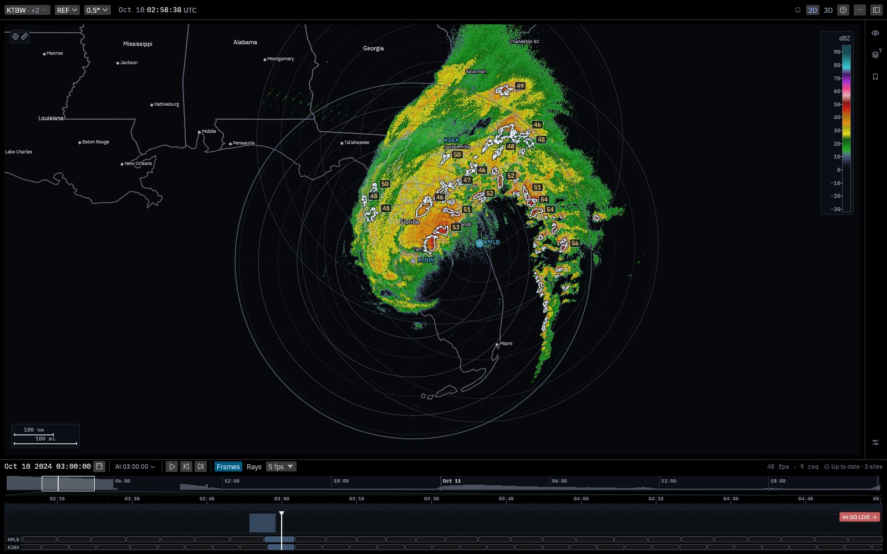

**Three radars, one map.** Milton at 03:00 UTC on 10 October 2024 from Tampa Bay, Melbourne and Jacksonville. The newer frame draws on top where discs overlap, storm cells are found once across all three, and each extra site gets its own lane under the timeline.

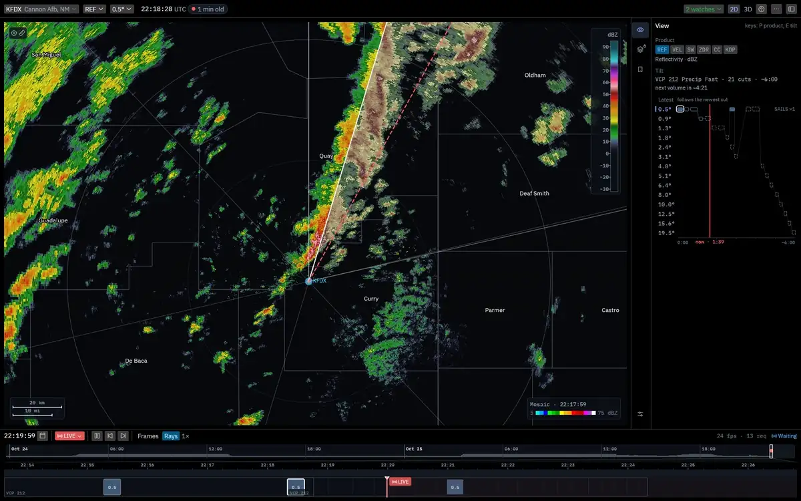

**Live.** KFDX at Cannon AFB, New Mexico, on 25 October 2026, streaming in Rays mode at 1× and sped up here. The sweep line paints the newest 0.5° data as each chunk arrives from the radar, the older scan ahead of it fades, and the dashed red line marks where the antenna is pointing now. Each finished 0.5° pass appears as a block in the lane under the timeline.

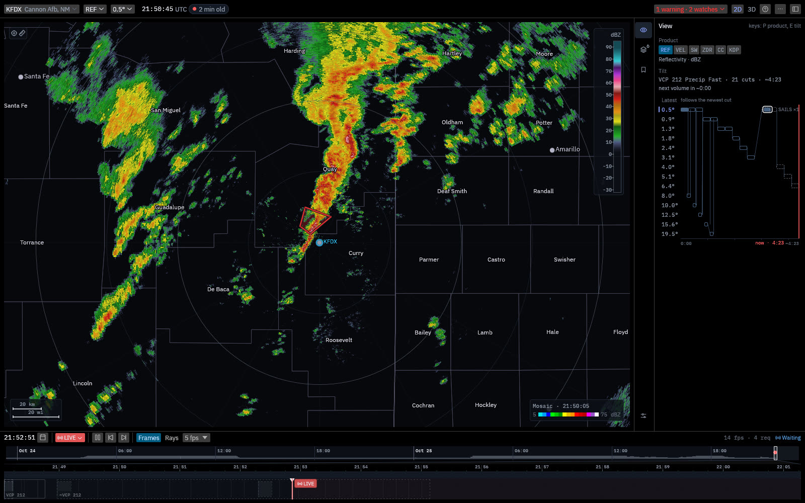

**Warnings.** The same storm half an hour earlier, inside a tornado warning from NWS Albuquerque. The warning count at top right opens the list, and the national mosaic is on.

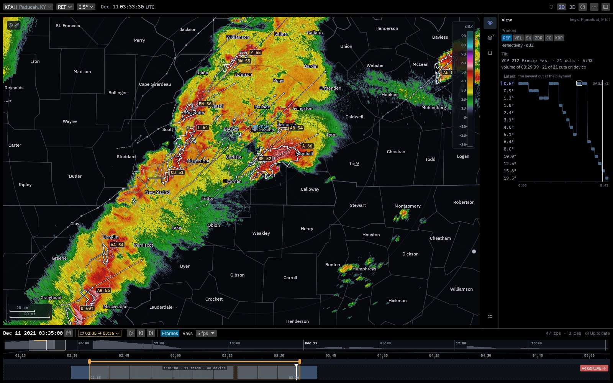

**Storm tracks.** The Paducah radar at 03:33 UTC on 11 December 2021, with an hour of the outbreak loaded. Cell A, over Marshall County, is the supercell that passed through Mayfield a few minutes earlier. Each lettered cell trails the path it has taken, and the dashed arrows point to where it should be in 30 minutes.

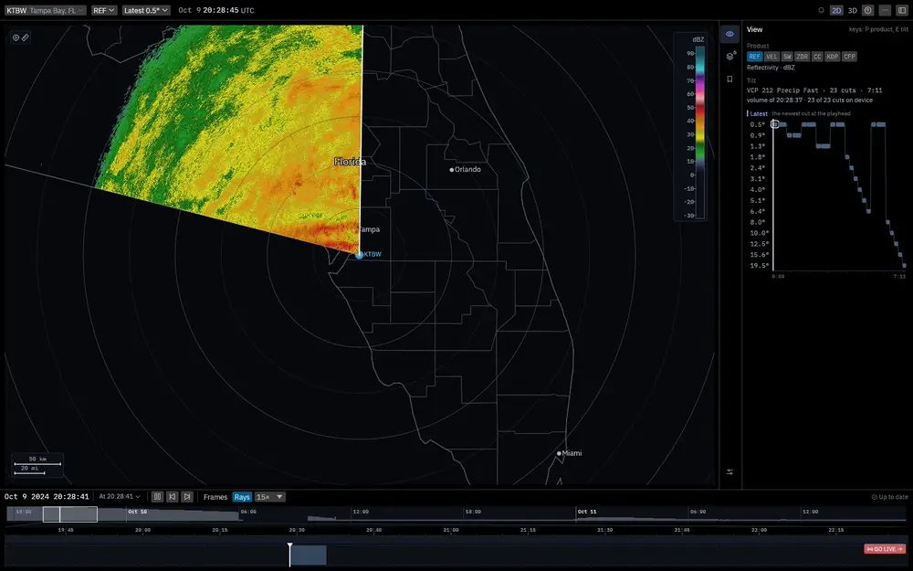

**Ray by ray.** In Rays mode the playhead follows the antenna. The sweep line paints each new tilt over the previous one, which fades, and the tilt ladder on the right tracks which elevation the radar is on.

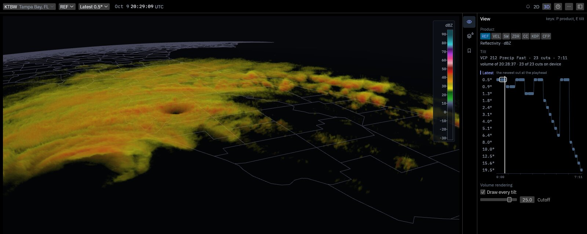

**Every tilt at once.** On the 3D globe, volume rendering draws all 23 tilts of a scan together, here with a 25 dBZ cutoff so the tall cells in Milton's outer bands stand out.

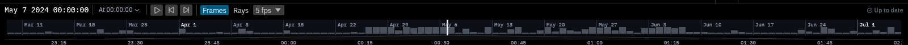

**Where the weather was.** The overview strip zoomed out to four months at KTLX in 2024: a quiet March, then the busy weeks of late April through June.

<table>
  <tr>
    <td width="50%">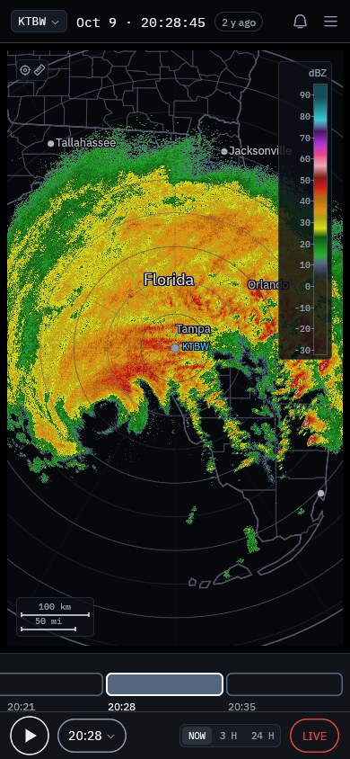</td>
    <td width="50%">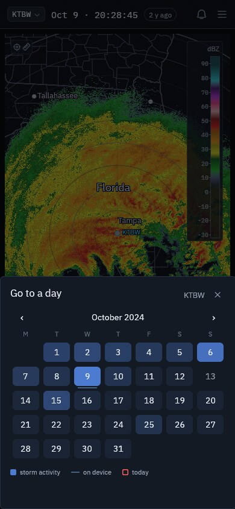</td>
  </tr>
  <tr>
    <td>On a phone.</td>
    <td>Going to a day: stormy days are shaded, so the days around Milton stand out.</td>
  </tr>
</table>

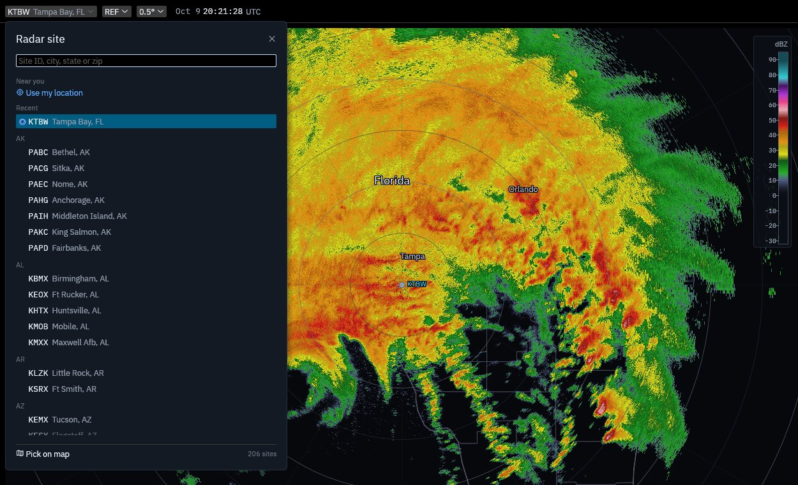

Search for a radar by ID, city, state or zip, use your location, or pick one on the map.

## Install it as an app

You can install NEXRAD Workbench so it opens in its own window, without the
browser's address bar, from an icon on your home screen, dock or start menu.

| On | Do this |
|----|---------|
| iPhone or iPad | Open the site in Safari, tap the Share button, then **Add to Home Screen** |
| Android | Open the site in Chrome, open the ⋮ menu, then **Add to home screen** or **Install app** |
| Mac | In Safari, choose **File › Add to Dock**. In Chrome or Edge, use the install icon at the right of the address bar |
| Windows, Linux, ChromeOS | In Chrome or Edge, use the install icon at the right of the address bar, or find **Install** in the browser menu |

The installed app is the same site and updates itself when a new version is
published. To remove it, delete it like any other app.

## Getting around

| To | Do this |
|----|---------|
| Change radar | Click the site name at top left, or press `S` |
| Show another radar beside it | In the site picker, choose **+ Also show** on a site's row |
| Change product or tilt | Use the menus in the top bar, or press `P` / `E` |
| Scrub | Drag the playhead along the timeline |
| Jump to a date | Click the calendar beside the clock, or press `G` |
| Loop a stretch | Drag across the thin strip above the volumes, or press `I` and `O` |
| Play, pause, step | `Space`, and `←` / `→` to step a frame |
| Go back to live | Press **Go live**, or `L` |
| Switch 2D / 3D | Use the buttons at top right, or press `T` |
| See every shortcut | Press `?` |

## Where the data comes from

Radar data is the NOAA NEXRAD Level II archive and real-time feed, hosted
openly on AWS by the
[NOAA Open Data Dissemination program](https://registry.opendata.aws/noaa-nexrad/)
with Unidata. Warnings come from the [National Weather Service API](https://www.weather.gov/documentation/services-web-api),
and storm reports from [mPING](https://mping.ou.edu/). The app downloads
straight from those sources and caches what it has fetched in your browser,
so returning to a storm you've already loaded costs nothing.

Decoding is done by the [`nexrad`](https://github.com/danielway/nexrad) Rust
crates, which are developed alongside this app.

## How it's built

The app is Rust compiled to WebAssembly, with an [egui](https://github.com/emilk/egui)
interface and WebGL2 rendering. Web Workers download, decompress and decode the
radar volumes, then store each sweep in IndexedDB ready to draw. The GPU turns
the raw values into colors, which keeps scrubbing and tilt changes instant.

Want to build it, run it locally or contribute? Start with
[CONTRIBUTING.md](CONTRIBUTING.md). The engineering docs are indexed in
[docs/](docs/README.md).
